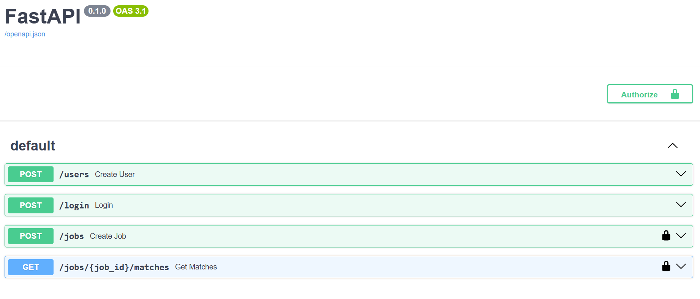
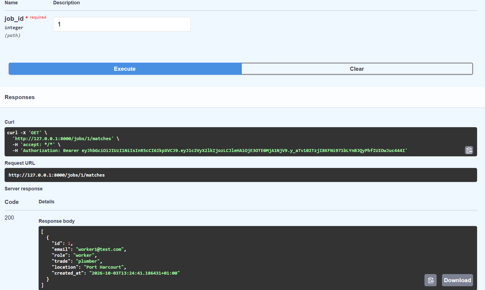

# Trades Marketplace Backend

A FastAPI + PostgreSQL backend for a blue-collar services marketplace.

## Features
- User authentication (consumer/worker roles) with JWT tokens
- Password hashing with bcrypt
- Job posting by consumers
- Matching workers to jobs by trade and location

## Tech Stack
Python, FastAPI, PostgreSQL, SQLAlchemy, Pydantic, JWT, bcrypt

## API Documentation

## Example: matching a worker to a job
